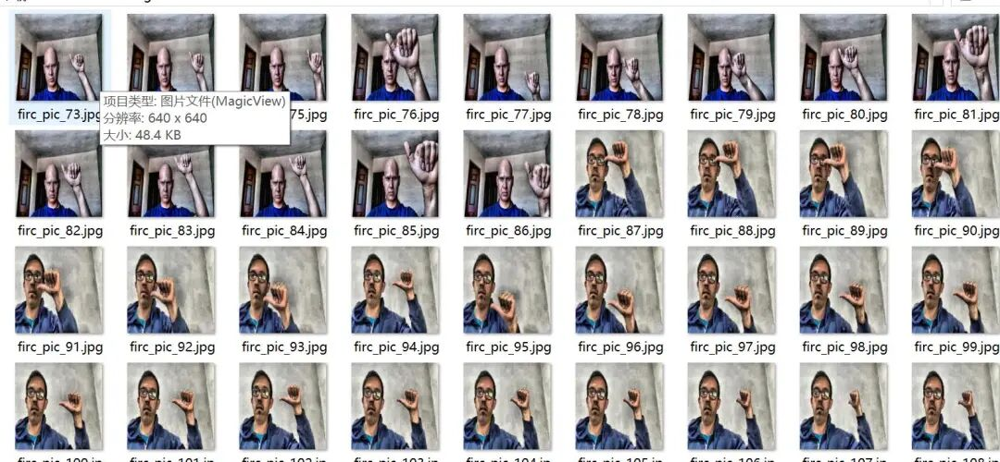
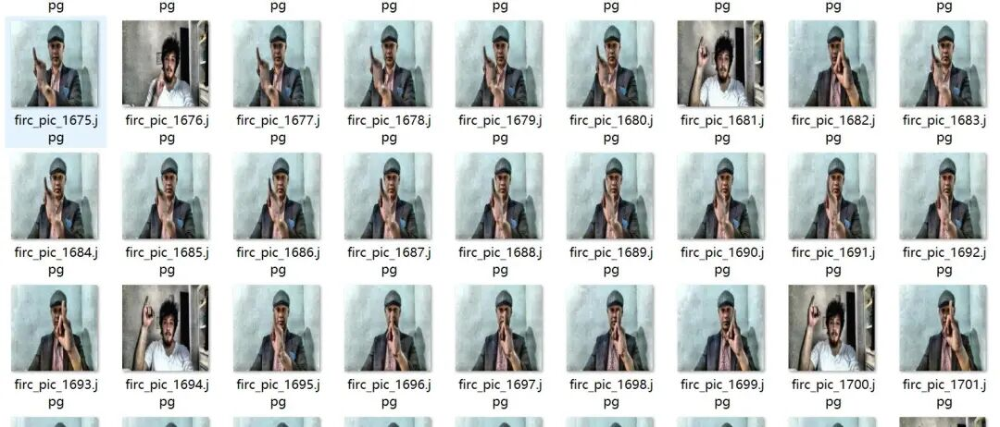
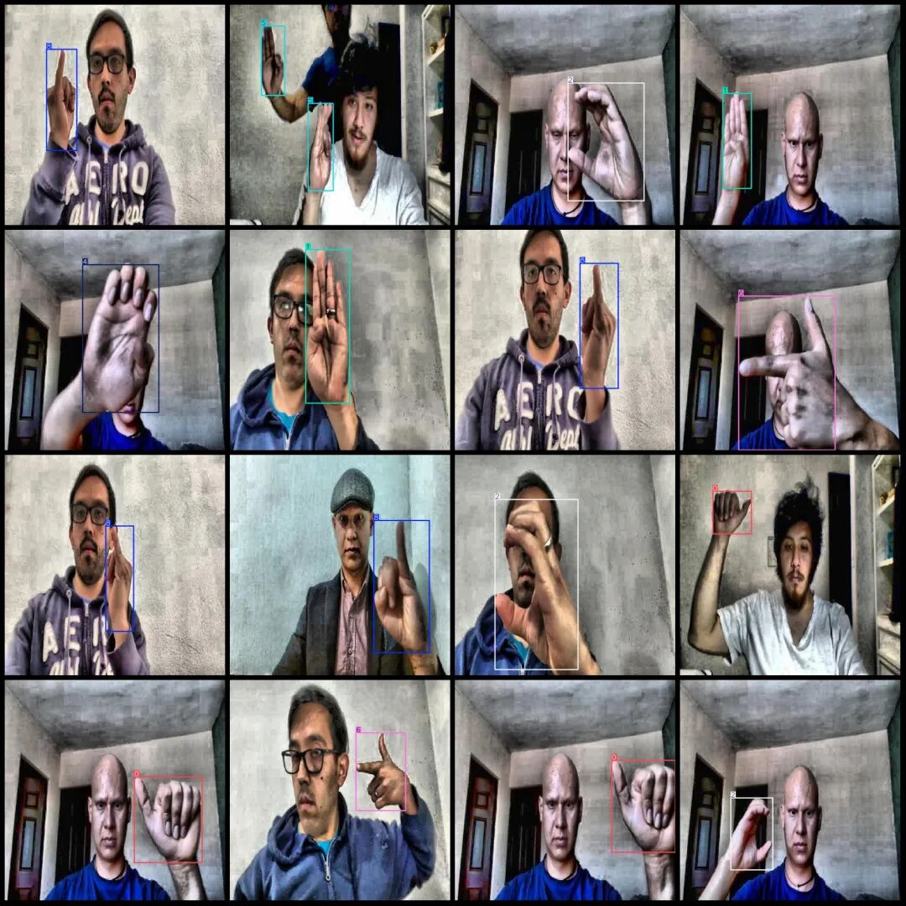
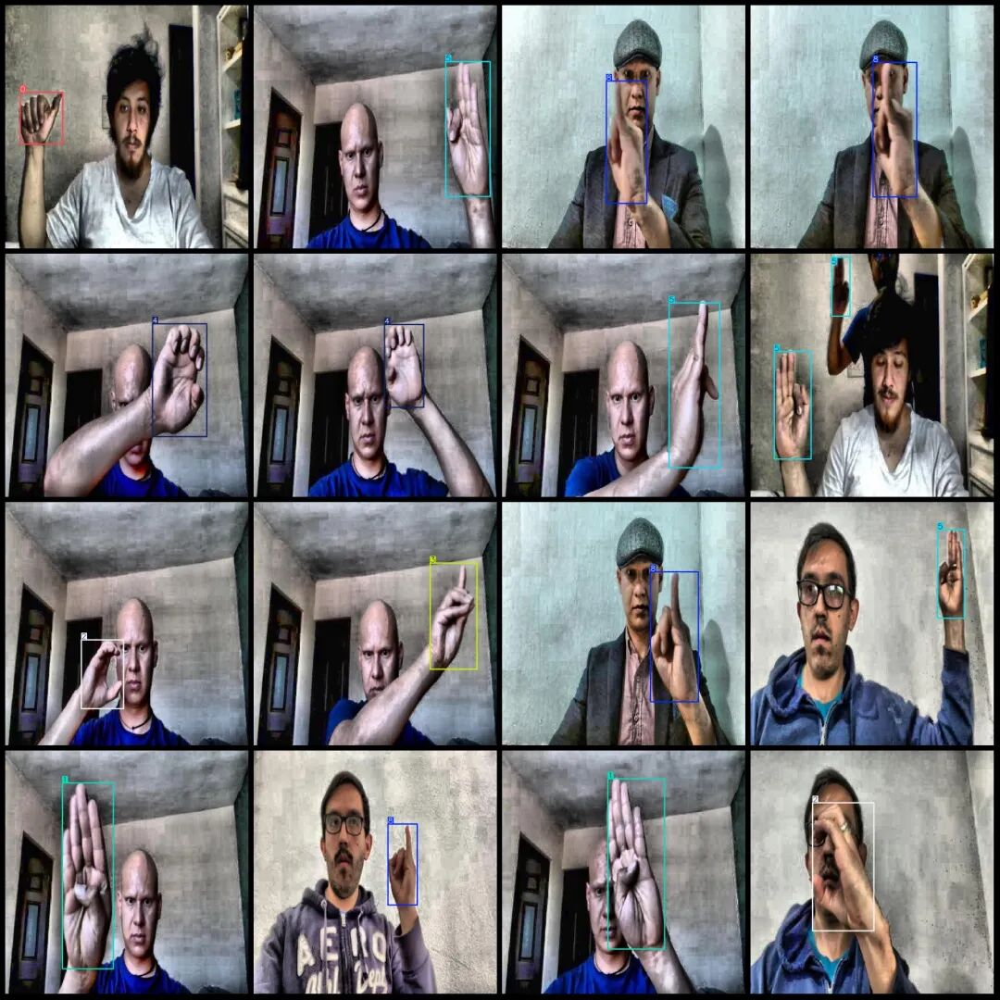

# VOC+YOLO format: 2000 images with 10 categories for gesture recognition detection dataset

Dataset format: Pascal VOC format + YOLO format (txt file without split path, only containing jpg images and corresponding VOC format xml files and yolo format txt files)

Number of images (number of jpg files): 2000

Number of annotations (number of xml files): 2000

Number of annotations (number of txt files): 2000

Label category count: 10

Label category names (Note that the order of yolo format categories does not correspond to this, but is based on the classes.txt in the labels folder): ["0", "1", "2", "3", "4", "5", "6", "7", "8", "9"]

Number of boxes labeled in each category:

0 Frames = 200

1 Frames = 200

2. Frames = 200

3 Frames = 200

4 Frames = 211

5 Frames = 228

6 Frames = 234

7 Frames = 200

8 Frames = 200

9 Frames = 200

Total frame count: 2073

Number of images per category:

0. Number of images owned = 200

1. Number of images owned = 200

2. Number of images owned = 200

3. Number of images owned = 200

4. Number of images owned = 199

5. Number of images owned = 201

6. Number of images owned = 200

7. Number of images owned = 200

8. Number of images owned = 200

9. Number of images owned = 200

Image resolution: 640x640

Using labelImg:

Annotation rules: Draw a rectangle around the category.

Important Notice: The dataset does not have separate training, validation, and test sets; you need to partition them yourself.

Special : This dataset does not guarantee the accuracy of the trained models or weight files.

Image Preview:

Annotation example:

## Payment

Here is a pay link on Stripe ( https://buy.stripe.com/3cs8yP7sY87d0vu9AB ). Please contact me lonlonago@foxmail.com after funding $89, and I will send you a complete data files , thank you!

